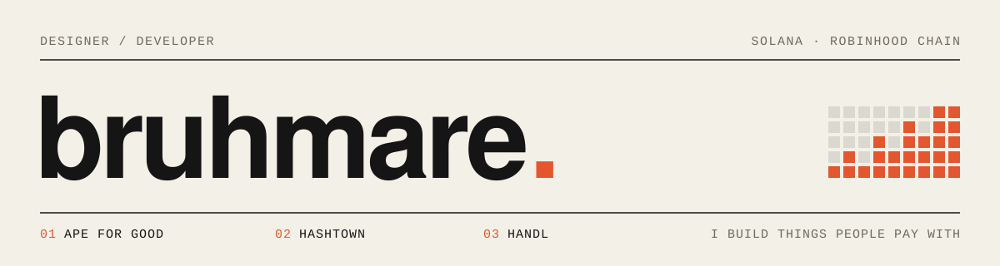
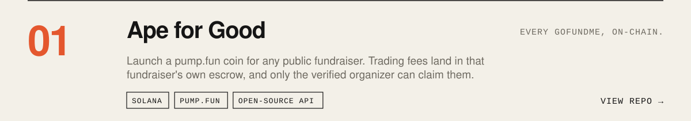
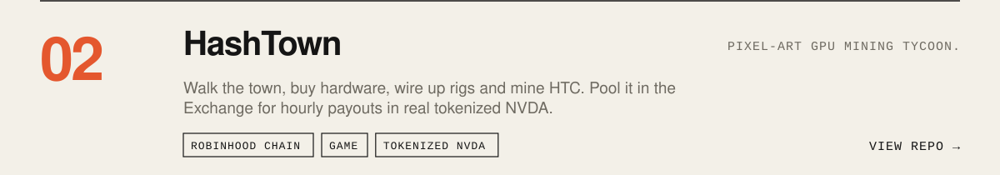
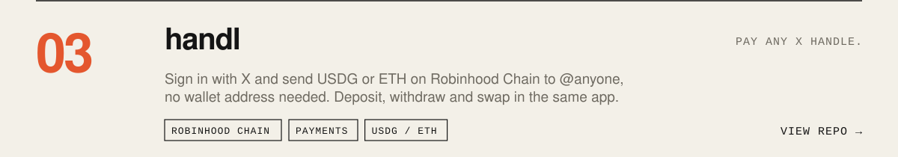

<picture>
  <source media="(prefers-color-scheme: dark)" srcset="assets/banner-dark.svg">
  
</picture>

I design and build products on Solana and Robinhood Chain, from the interface down to the contracts and the backend that pays people out.

<a href="https://github.com/Bruhmare/ape-for-good">
  <picture>
    <source media="(prefers-color-scheme: dark)" srcset="assets/ape-dark.svg">
    
  </picture>
</a>
<a href="https://github.com/Bruhmare/hashtown">
  <picture>
    <source media="(prefers-color-scheme: dark)" srcset="assets/hashtown-dark.svg">
    
  </picture>
</a>
<a href="https://github.com/Bruhmare/handl-finance">
  <picture>
    <source media="(prefers-color-scheme: dark)" srcset="assets/handl-dark.svg">
    
  </picture>
</a>

**Live:** [Ape for Good](https://charity-ruddy-mu.vercel.app) · [HashTown](https://www.hashtown.io) · [handl](https://handl.finance)

**Toolbox:** JavaScript · TypeScript · SvelteKit · Node · Solidity · Solana web3
